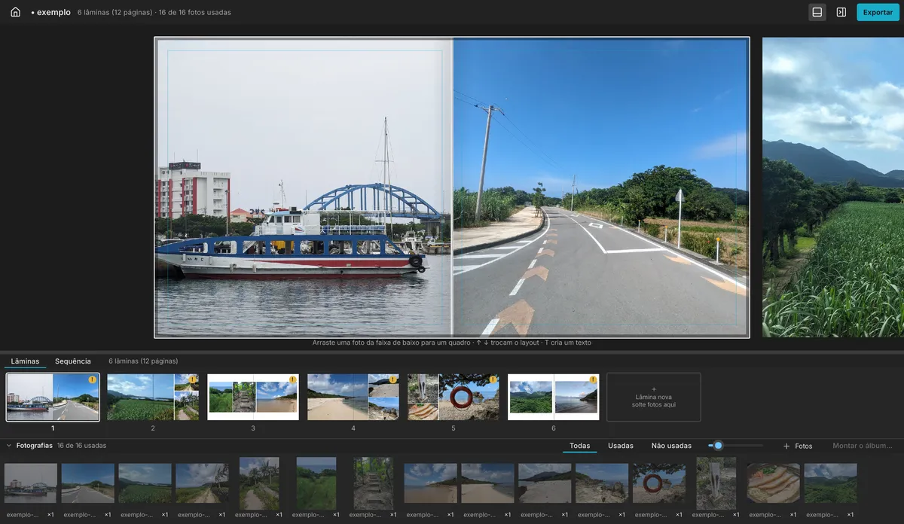
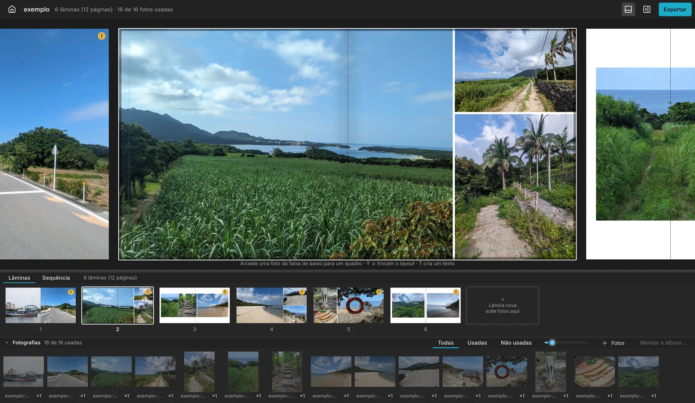
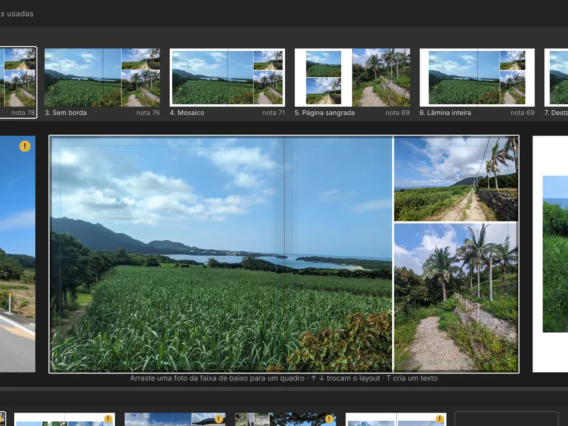
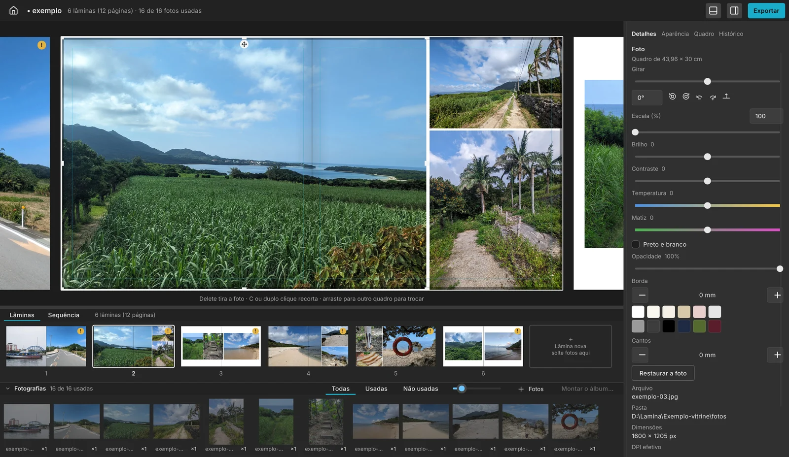
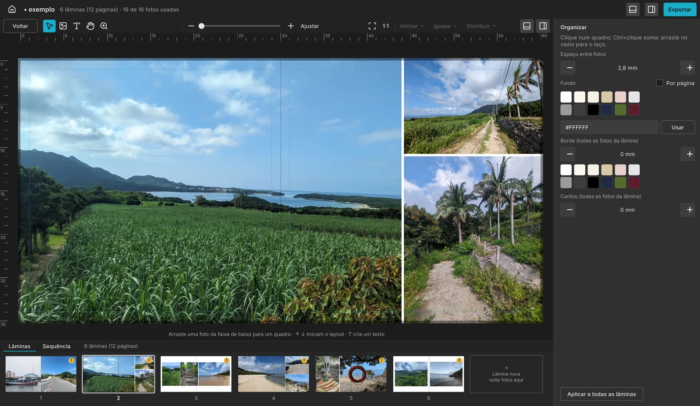
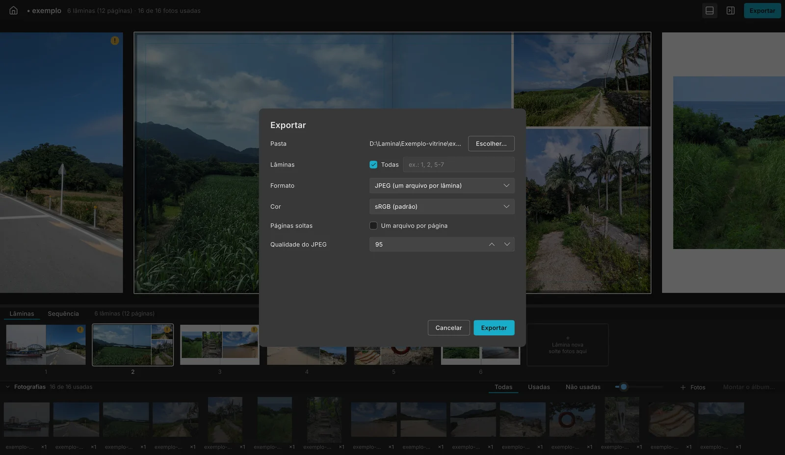
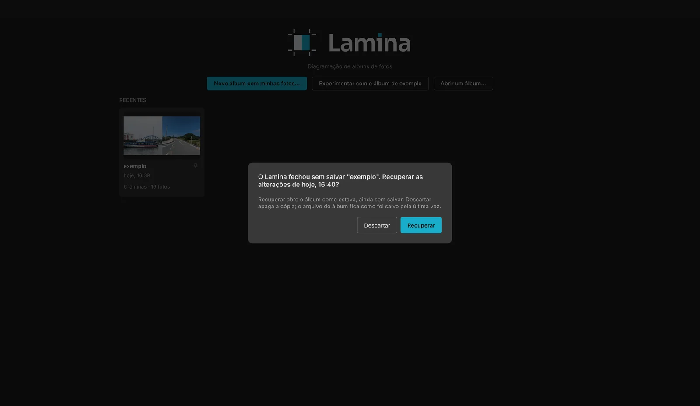

<div align="center">

<picture>
  <source media="(prefers-color-scheme: dark)" srcset="site/midia/logo-escuro.svg">
  
</picture>

### Diagramador de álbuns de fotografia — grátis, de código aberto, para Windows, Mac e Linux

Escolha a pasta das fotos e o Lamina monta o álbum, lâmina por lâmina. Depois é trocar layouts,
ajustar as fotos e mandar para a gráfica.

[](https://github.com/alberthpalhares/lamina-app/releases)
[](https://github.com/alberthpalhares/lamina-app/releases)
[](LICENSE)
[](https://github.com/alberthpalhares/lamina-app/actions/workflows/ci.yml)

[](https://github.com/alberthpalhares/lamina-app/releases/download/v0.1.0-beta.8.1/Lamina-win-beta-Setup.exe)
[](https://github.com/alberthpalhares/lamina-app/releases/download/v0.1.0-beta.8.1/Lamina-osx-beta-Setup.pkg)
[](https://github.com/alberthpalhares/lamina-app/releases/download/v0.1.0-beta.8.1/Lamina-linux-beta.AppImage)

<sub>Versão 0.1.0-beta.8.1 · [como instalar sem susto](#instalar) · [site](https://alberthpalhares.github.io/lamina-app/) · [todas as versões](https://github.com/alberthpalhares/lamina-app/releases)</sub>



</div>

> [!IMPORTANT]
> **Na primeira vez, o Windows e o Mac vão avisar que não reconhecem o Lamina.** Isso acontece
> porque o Lamina não paga a assinatura de desenvolvedor da Microsoft e da Apple, e não quer
> dizer vírus. Abaixo, em [Instalar](#instalar), há um plano para cada sistema: o caminho mais
> curto, o caminho pelos cliques (com as telas) e uma saída de reserva.

## Sumário

- [Por que o Lamina](#por-que-o-lamina)
- [Lamina e os programas de diagramação comuns](#lamina-e-os-programas-de-diagramação-comuns)
- [Instalar](#instalar)
- [Por dentro do Lamina](#por-dentro-do-lamina)
- [Grátis e versão de apoiador](#grátis-e-versão-de-apoiador)
- [Usar com o Claude Desktop](#usar-com-o-claude-desktop)
- [Perguntas frequentes](#perguntas-frequentes)
- [Sugestões e problemas](#sugestões-e-problemas)
- [Para quem programa](#para-quem-programa)
- [Licença e créditos](#licença-e-créditos)

## Por que o Lamina

<table>
  <tr>
    <td width="33%" valign="top">
      <br>
      <b>Layouts feitos para as suas fotos.</b> Cada layout é calculado pela proporção de cada
      foto, sem biblioteca fixa de modelos. As fotos maiores vêm primeiro, inclusive sem borda, e
      você escolhe quanto o Lamina pode cortar. <kbd>↑</kbd> e <kbd>↓</kbd> trocam de layout;
      <kbd>L</kbd> mostra todos de uma vez.
    </td>
    <td width="33%" valign="top">
      <br>
      <b>O álbum montado sozinho.</b> A montagem automática agrupa as fotos por momento, cuida do
      ritmo e da variedade das lâminas e explica por que escolheu cada layout.
    </td>
    <td width="33%" valign="top">
      <br>
      <b>Rápido com milhares de fotos.</b> Feito em Rust: cada mudança aparece na tela em menos de
      40 ms, e 1.000 fotos de 24 MP entram em menos de um minuto.
    </td>
  </tr>
  <tr>
    <td width="33%" valign="top">
      <br>
      <b>Ajustes da foto na hora.</b> Endireitar com precisão de 0,1°, brilho, contraste, preto e
      branco, temperatura, matiz, opacidade e borda, iguais na tela e na impressão.
    </td>
    <td width="33%" valign="top">
      <br>
      <b>Nunca perde trabalho.</b> Cópia de segurança a cada minuto, com a pergunta "Recuperar?"
      se o computador desligar, e um histórico que volta a qualquer passo.
    </td>
    <td width="33%" valign="top">
      <br>
      <b>Pronto para a gráfica.</b> PDF/X-4, TIFF sem perda e JPEG de qualidade 95 com cor 4:4:4,
      marcas de corte, tamanho real 1:1 na tela e uma pré-impressão que aponta os problemas
      antes de exportar.
    </td>
  </tr>
</table>

## Lamina e os programas de diagramação comuns

| | **Lamina** | **O que é comum em outros programas** |
|---|---|---|
| Preço | Grátis; licença de apoiador opcional, R$ 99 por versão maior | Assinatura mensal ou licença paga |
| Sistemas | Windows, Mac (Intel e Apple) e **Linux** | Windows e Mac |
| Conta e internet | Não precisa de conta; funciona sem internet | Conta e ativação pela internet |
| Seus dados | Não envia nada sozinho, sem telemetria | Varia |
| Código | Aberto (Apache-2.0): qualquer pessoa pode conferir | Fechado |
| Layouts | Calculados para a proporção de cada foto | Biblioteca fixa de modelos |
| Segurança do trabalho | Cópia automática a cada minuto e histórico completo | Varia |
| Arquivo final | O mesmo álbum gera sempre os mesmos arquivos, byte a byte | Raramente garantido |
| IA | Controle pelo Claude Desktop (MCP), com cada passo desfazível | Raro |

<sub>Comparação geral com o que é comum no mercado de diagramação de álbuns; cada programa tem seus
pontos fortes.</sub>

## Instalar


**Por que o aviso aparece?** A Microsoft e a Apple cobram uma assinatura anual para "reconhecer"
um programa. O Lamina é gratuito e não paga essa assinatura, então o sistema mostra um aviso
genérico na primeira vez. Para você confiar sem precisar acreditar na nossa palavra:

- o código é aberto e cada instalador é montado pelo GitHub Actions, à vista de todos, a partir
  deste código ([veja as compilações](https://github.com/alberthpalhares/lamina-app/actions/workflows/release.yml));
- cada versão publica o arquivo `SHA256SUMS`, para você conferir que o arquivo baixado é o mesmo
  (veja [Conferir o download](#conferir-o-download));
- depois de instalado, o Lamina se atualiza sozinho, sem o aviso.

<details open>
<summary><b>Windows 10 e 11</b></summary>

**Plano A — pelo PowerShell (sem aviso).** Abra o menu Iniciar, digite `PowerShell`, abra e cole:

```powershell
irm https://raw.githubusercontent.com/alberthpalhares/lamina-app/main/crates/lamina-app/dist/instalar.ps1 | iex
```

O comando baixa a versão mais nova, confere o SHA-256 e instala na sua pasta de usuário, sem
pedir senha de administrador. O aviso não aparece porque o arquivo não passou pelo navegador; o
antivírus continua examinando tudo normalmente.

**Plano B — pelo navegador (com o aviso).**

1. Baixe o [`Setup.exe`](https://github.com/alberthpalhares/lamina-app/releases/download/v0.1.0-beta.8.1/Lamina-win-beta-Setup.exe).
2. Se o navegador segurar o arquivo: no **Edge**, clique nos três pontinhos ao lado do download →
   **Manter** → **Mostrar mais** → **Manter mesmo assim**; no **Chrome**, clique em **Manter**.
3. Abra o arquivo. Na janela azul **"O Windows protegeu o computador"**, clique em
   **Mais informações** (o texto pequeno) e depois em **Executar assim mesmo**.

**Plano C — desbloquear antes de abrir.** Se o botão "Executar assim mesmo" não aparecer (alguns
computadores de empresa escondem), clique com o botão direito no `Setup.exe` → **Propriedades** →
marque **Desbloquear** embaixo, em Segurança → **OK**, e abra de novo. Pelo PowerShell, o mesmo:

```powershell
Unblock-File "$HOME\Downloads\Lamina-win*-Setup.exe"
```

</details>

<details>
<summary><b>Mac (Intel e Apple)</b></summary>

**Plano A — pelo Terminal (sem aviso).** Abra o Terminal (Launchpad → Outros → Terminal) e cole:

```sh
curl -fsSL https://raw.githubusercontent.com/alberthpalhares/lamina-app/main/crates/lamina-app/dist/instalar.sh | sh
```

O Lamina vai para a pasta **Aplicativos** e passa a abrir os arquivos `.lamina` com dois cliques.

**Plano B — pelo instalador (com o aviso).**

1. Baixe o [`Setup.pkg`](https://github.com/alberthpalhares/lamina-app/releases/download/v0.1.0-beta.8.1/Lamina-osx-beta-Setup.pkg) e abra.
2. Se o Mac disser que **não pode verificar o desenvolvedor**, clique em **OK** (ou **Concluído**).
3. Abra **Ajustes do Sistema** → **Privacidade e Segurança**, role até o fim e, ao lado da
   mensagem sobre o Lamina, clique em **Abrir mesmo assim**. Confirme com a senha do Mac.
4. Isso pode acontecer duas vezes: no instalador e ao abrir o Lamina pela primeira vez.

No macOS 15 (Sequoia) ou mais novo, o antigo atalho "botão direito → Abrir" deixou de liberar
programas: use o passo 3.

**Plano C — pelo Terminal, depois de instalar.** Se o Mac continuar dizendo que o Lamina "está
danificado" ou não abrir, tire a marca de "baixado da internet" e abra de novo:

```sh
xattr -dr com.apple.quarantine /Applications/Lamina.app
```

</details>

<details>
<summary><b>Linux (x64)</b></summary>

**Plano A — pelo terminal:**

```sh
curl -fsSL https://raw.githubusercontent.com/alberthpalhares/lamina-app/main/crates/lamina-app/dist/instalar.sh | sh
```

O Lamina fica em `~/.local/bin/Lamina.AppImage`; abra uma vez por ele para o atalho entrar no menu.

**Plano B — pelo navegador.** Baixe o [`.AppImage`](https://github.com/alberthpalhares/lamina-app/releases/download/v0.1.0-beta.8.1/Lamina-linux-beta.AppImage), clique com o botão direito →
Propriedades → **Permitir executar como programa** (ou `chmod +x Lamina-linux*.AppImage`) e abra.

**Se nada abrir:** instale o FUSE 2 — `sudo apt install libfuse2` (no Ubuntu 24.04 ou mais novo,
`libfuse2t64`).

</details>

### Conferir o download

Na página da versão, o arquivo `SHA256SUMS` traz a "impressão digital" de cada instalador.
Compare com a do arquivo que você baixou:

```powershell
Get-FileHash "$HOME\Downloads\Lamina-win*-Setup.exe"   # Windows (PowerShell)
```

```sh
shasum -a 256 ~/Downloads/Lamina-osx*-Setup.pkg        # Mac
sha256sum ~/Downloads/Lamina-linux*.AppImage           # Linux
```

Se o antivírus acusar o Lamina, é quase sempre um alarme falso de programa sem assinatura: confira
o SHA-256, envie o arquivo para análise da Microsoft em
<https://www.microsoft.com/wdsi/filesubmission> e nos avise numa
[issue](https://github.com/alberthpalhares/lamina-app/issues/new/choose).

**Versões de teste:** os comandos instalam a versão estável mais nova (enquanto não houver uma, a
de teste mais nova). Para ficar sempre com a de teste, rode `$env:LAMINA_BETA = 1` antes do comando no Windows, ou troque o fim por
`| sh -s -- --beta` no Mac e no Linux. O [guia de instalação](crates/lamina-app/dist/instalar.md)
tem cada clique, com as telas.

## Por dentro do Lamina

Na tela de boas-vindas, **Álbum de exemplo** abre um álbum pronto, com fotos
livres, para você ver tudo funcionando. Depois, **Novo álbum…** monta o seu.

<table>
  <tr>
    <td width="50%" valign="top"><br><b>O álbum inteiro à vista.</b> A lâmina grande em cima; embaixo, lâminas (reordene arrastando) e sequência em abas, e as fotos.</td>
    <td width="50%" valign="top"><br><b>Faixa de layouts.</b> <kbd>L</kbd> mostra todas as opções para as fotos da lâmina, com nota; as setas passam por elas.</td>
  </tr>
  <tr>
    <td width="50%" valign="top"><br><b>Ajustes da foto.</b> Girar, escala, brilho, contraste, temperatura e matiz por controles deslizantes.</td>
    <td width="50%" valign="top"><br><b>Modo organizar.</b> Régua, lupa, tamanho real 1:1, espaço entre fotos, fundo, bordas e cantos.</td>
  </tr>
  <tr>
    <td width="50%" valign="top"><br><b>Exportar.</b> JPEG qualidade 95, PDF de impressão (PDF/X-4) ou TIFF sem perda, em sRGB ou Adobe RGB.</td>
    <td width="50%" valign="top"><br><b>Nada se perde.</b> Se o Lamina ou o computador desligar, ele pergunta se quer recuperar o trabalho.</td>
  </tr>
</table>

<details>
<summary><b>Todos os recursos</b></summary>

**Diagramação**
- Montagem automática do álbum inteiro, com relatório de cada escolha.
- Layouts pela proporção de cada foto; <kbd>↑</kbd> e <kbd>↓</kbd> trocam, <kbd>←</kbd> e
  <kbd>→</kbd> passam de lâmina, <kbd>E</kbd> espelha, <kbd>F</kbd> favorita, <kbd>X</kbd> rejeita.
- Rolo de lâminas, fotos arrastadas de uma lâmina para outra, lâminas reordenadas arrastando.
- Álbum que começa em branco, modelos de lâmina e tamanhos próprios.
- Texto com 6 fontes embutidas, igual na tela e na impressão.
- Modo organizar: alinhar, igualar, distribuir, lupa até 8× e tamanho real 1:1 calibrado.

**Foto**
- Endireitar (0,1°), girar de −180° a 180°, escala de 100% a 800%.
- Brilho, contraste, preto e branco, temperatura, matiz, opacidade, borda e cantos.
- Fotos que mudaram de pasta são reencontradas.

**Impressão**
- JPEG qualidade 95 com cor 4:4:4 e perfil de cor, TIFF sem perda, PDF/X-4.
- sRGB ou Adobe RGB, marcas de corte, pré-impressão com "Ir para a lâmina".
- O mesmo álbum gera sempre os mesmos arquivos.

**Para trabalhar tranquilo**
- Cópia de segurança a cada minuto, histórico completo, atualização automática.
- Erros explicados em linguagem de fotógrafo, atalhos com busca (<kbd>F1</kbd>).
- Tudo em português do Brasil.

</details>

## Grátis e versão de apoiador

O Lamina é e continua **grátis e de código aberto**. Montar o álbum, layouts, cortar, girar,
escala, brilho, contraste, preto e branco, texto com as fontes embutidas, JPEG, TIFF e PDF/X-4 em
sRGB com marcas de corte, cópia de segurança e atualizações são livres, sem prazo.

Quem quiser apoiar o projeto pode comprar a **licença de apoiador: R$ 99 por versão maior** (a
licença da 1 vale em toda a 1.x), sem conta e sem cadastro. Ela libera:

| Recurso de apoiador | No grátis |
|---|---|
| Editar temperatura e matiz | Zerar continua livre |
| Salvar tamanhos próprios e modelos de lâmina | Os 15 tamanhos prontos e o tamanho digitado à mão são livres |
| Exportar em Adobe RGB | Exporta em sRGB |
| O programa `lamina` no terminal | — |
| O controle por IA (Claude Desktop) | — |
| Fontes instaladas no computador | As 6 fontes embutidas são livres |

Nada se perde no grátis: um álbum feito com recursos de apoiador abre, aparece e exporta igual.
O link de compra aparece aqui e no menu Ajuda do Lamina quando a venda abrir.

## Usar com o Claude Desktop

Na página da versão, baixe `Lamina-Windows.mcpb` ou `Lamina-macOS.mcpb` e dê dois cliques: o
Claude Desktop instala o Lamina e pergunta as pastas dos álbuns. Daí é pedir em português —
"monte a lâmina 3 com as fotos da igreja", "o que falta antes de mandar para a gráfica?" — e cada
edição entra no histórico do Lamina como "IA: …", pronta para desfazer.

**Com "Permitir que a IA veja as fotos" ligada, as prévias das lâminas e as miniaturas das fotos
vão para o provedor da IA** (no Claude, a Anthropic). São fotos de clientes (LGPD): desligue a
opção se o contrato pedir; a IA continua só com os dados das fotos e das lâminas.

## Perguntas frequentes

<details>
<summary><b>O aviso do Windows ou do Mac quer dizer que o Lamina tem vírus?</b></summary>

Não. O aviso aparece para qualquer programa que não paga a assinatura da Microsoft ou da Apple. O
código do Lamina é aberto, os instaladores são montados pelo GitHub Actions a partir dele, e o
`SHA256SUMS` de cada versão permite conferir o arquivo.
</details>

<details>
<summary><b>Preciso de internet?</b></summary>

Só para baixar e para as atualizações. O Lamina funciona sem internet, sem conta e não envia nada
sozinho.
</details>

<details>
<summary><b>Meus álbuns ficam onde?</b></summary>

No seu computador, num arquivo `.lamina` que guarda o álbum e aponta as fotos nas pastas
originais. As fotos nunca são copiadas nem alteradas.
</details>

<details>
<summary><b>O que acontece se o Lamina fechar no meio do trabalho?</b></summary>

Ao abrir de novo, ele pergunta "Recuperar?" e volta o trabalho da última cópia de segurança, feita
a cada minuto.
</details>

<details>
<summary><b>Como atualizo?</b></summary>

O Lamina avisa sozinho quando há versão nova e se atualiza com um clique, sem o aviso do sistema.
</details>

## Sugestões e problemas

No Lamina, **Ajuda → Enviar sugestão ou problema…** abre um formulário curto, sem precisar de
conta, já com a versão do programa. Se algo deu errado, **Ajuda → Abrir pasta de registros**
mostra o arquivo `lamina.log` para anexar. Quem tem conta no GitHub também pode abrir uma
[issue](https://github.com/alberthpalhares/lamina-app/issues/new/choose). Nunca anexe fotos de
clientes.

## Para quem programa

O Lamina é escrito em Rust, com a interface em Slint.

```sh
cargo run --release -p lamina-app   # a janela
cargo xtask verify                  # formatação, lint, testes e checagens
```

No Linux, a janela precisa de `libfontconfig1-dev`, `libxkbcommon-dev` e `libwayland-dev`. Veja
como contribuir em [`.github/CONTRIBUTING.md`](.github/CONTRIBUTING.md).

## Licença e créditos

- Código: Apache-2.0 (arquivo [`LICENSE`](LICENSE)).
- Interface: [Slint](https://slint.dev), sob a licença Royalty-free 2.0.
- Fontes em `crates/lamina-render/fonts/`: SIL OFL 1.1 (o `OFL.txt` fica na pasta de cada uma).
- Fotos do álbum de exemplo e das telas desta página: CC0 1.0, de Syced no Wikimedia Commons
  ([créditos](crates/lamina-app/exemplo/CREDITOS.md)).

[](https://slint.dev)
